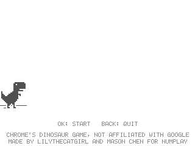
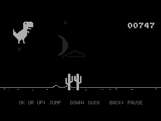
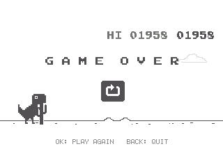

# Chrome Dino

Chrome's dinosaur game, the one you get when you're offline, on the NumWorks calculator. It plays and looks the way Chrome plays it on a screen as wide as the calculator's.

- **Chrome's own game**: its rules, numbers and pictures come from Chrome's source, run at Chrome's 60 frames a second.
- **Jump the cacti**, small and large, alone or in groups of up to three. Hold the jump key for a higher jump, or let go early for a short one.
- **Pterodactyls** from a fast enough speed on, at three heights: jump the low ones, duck under the ones flying at head height, and let the high ones fly over you.
- **Faster and faster**, up to Chrome's top speed. The score flashes at every 100 points.
- **Night** falls every 700 points: the screen fades to dark, with the moon in its phases and the stars, then day comes back.
- **Game over** with Chrome's crash, its GAME OVER and its restart button. Your best score is saved and shown as HI.

  

## Controls

| Key | Action |
| --- | --- |
| OK or Up (or 8) | Start, jump (hold it to jump higher) |
| Down (or 2) | Duck; in the air, come down faster |
| OK, after a crash | Play again |
| EXE, after a crash | Play again at once |
| Back | Pause: Resume, Restart, Quit game |
| Home | Quit |

## Credits

Chrome's dinosaur game is **Google**'s (2014). This version ports it from [Chromium's source](https://chromium.googlesource.com/chromium/src/+/main/components/neterror/resources/dino_game/), its code and its pictures, under Chromium's BSD license (see [LICENSE](LICENSE)). Not affiliated with Google. Chrome is a trademark of Google LLC.

**[LilyTheCatgirl](https://github.com/LilyTheCuteCatgirl)** brought the game to NumPlay, after her version for the calculator's Python in [Lily's Small NumWorks Games](https://github.com/LilyTheCuteCatgirl/lilys-small-numworks-games). Mason Chen made it follow Chrome's own code.

It comes inside [NumPlay](https://github.com/Mason363/NumPlay), or on its own as `ChromeDino.nwa` from the [latest release](https://github.com/Mason363/NumPlay/releases/latest).

Build: `make` (needs `arm-none-eabi-gcc` and Node.js for nwlink). Tests: `make host-test`. The pictures: `make sprites SHEET=100-offline-sprite.png`, from Chromium's sprite sheet (see `tools/sprites.py`).
