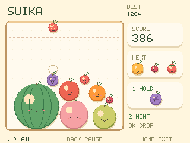
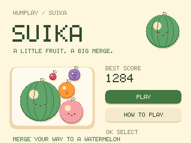
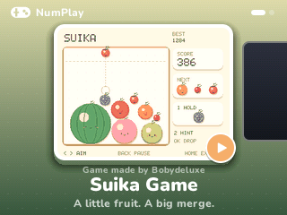

# Suika Game

An English-only fruit-merging game for NumWorks, rebuilt for NumPlay. Drop two
matching fruits together to grow the next one, from a cherry to a watermelon.
Two watermelons clear each other and award 66 points before combo bonuses.

**Game made by [Bobydeluxe](https://github.com/Bobydeluxe).**





| Key | Action |
| --- | --- |
| Left / Right | Aim |
| OK / EXE | Drop one fruit (holding does not repeat) |
| 1 | Hold or swap a fruit, once per drop |
| 2 | Suggest a position, preferring a visible matching fruit |
| Back | Pause / resume |
| Home / On-Off | Save and leave |

The dotted guide shows the first circular contact along a vertical fall. Green
means it reaches a matching fruit. This is a preview of the initial contact;
fruit can roll afterwards. The hint is optional and does not drop anything.
The next three fruits are visible. A shuffled eight-fruit bag contains three
cherries, two strawberries, two grapes and one mandarin.

A fruit gets time to fall before it counts toward overflow. Once a mature fruit
crosses the danger line, the red bar gives 180 simulation ticks (2.88 seconds)
to settle or merge before game over. Clearing the line resets the warning.
Filling the 48-body pool blocks new drops while the existing fruit settles.

Pause freezes simulation. Its **New game** action asks before discarding a run;
the record is kept. **Title screen** keeps the run available under **Continue**.
Back on the title returns to NumPlay. Home leaves the app.

## Memory and saves

No heap, full-screen framebuffer, image decompression, audio buffers or bundled
catalogue. Original fruit artwork is drawn procedurally. Only dirty screen
regions are composed, at most eight rows at a time (5120 bytes). Physics uses
two substeps and six contact passes per 16 ms tick; drawing is capped at 32 ms
intervals and at most four simulation ticks are caught up after a slow frame.

The versioned `suika.sav` record has a fixed 608-byte payload. It keeps the
current run, best, random generator, bag, preview, reserve and danger timer.
Coordinates and velocity use compact fixed-point fields on disk; live physics
uses the calculator's single-precision FPU. Checksum, length, fruit and bag
validation happen before loading any state. Writes occur on pause, game over,
exit and at five-second intervals while playing, skipping identical payloads.
An actual save failure is shown; failed exits allow retry, returning to play,
or explicit exit without saving. NumPlay's existing backup/reset/uninstall mechanisms cover the
registered record. This fresh implementation does not import NumGames saves.

## Build and check

With ARM GCC and nwlink 1.0.0 available:

```sh
make -C games/suika build check NWLINK=nwlink
make -C games/suika test
```

The result is `games/suika/output/suika.nwa`. The root build adds the module to
NumPlay and copies the standalone app to `build/apps/SuikaGame.nwa`.
The portable standalone build works on Windows too:

```sh
python games/suika/tools/build.py --toolchain /path/to/arm/bin --nwlink /path/to/nwlink/bin/nwlink
```

It also writes `output/SuikaGame.nwa` and a four-profile size report, enforcing
12 KiB static RAM and 64 KiB installed flash limits. It requires Pillow and
pyelftools. `tools/icon.py` regenerates the original icon with Pillow.

The host suite exercises coincident contacts, merges, maximum fruit, spawn
blocking, danger recovery, hold/cooldown, deterministic generation, geometric
previews, save corruption and 28,800 stress ticks. It also compares partial and
full renders and writes reference PPM captures. The repository ARM smoke test
checks save/reload, Home/On-Off exit, memory boundaries and stack use:

```sh
python tests/test_games.py build/apps --game suika
python tests/test_suika.py build/apps/SuikaGame.nwa
```

All code and procedural artwork are original to this implementation, under the
repository's GPL-3.0 licence. Inspired by the fruit-merging rules of Suika Game;
not affiliated with Aladdin X. No original game's artwork or binary is included.
